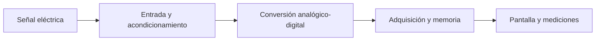

# 27.1 · ¿Qué es un osciloscopio?

> **Área:** Osciloscopio · Instrumentación y transmisión de señales  
> **Guía:** [Índice y navegación](./README.md)

En esta sección conocerás la definición del instrumento, qué información muestra su pantalla y cómo convierte señales eléctricas en gráficos y mediciones.

Un **osciloscopio** es un instrumento electrónico que representa gráficamente cómo cambia una magnitud eléctrica, normalmente **el voltaje**, a lo largo del tiempo. En su modo habitual de funcionamiento, el eje vertical representa voltaje (V) y el horizontal tiempo (s).

A diferencia de un multímetro, que normalmente ofrece una lectura numérica, el osciloscopio permite observar **la forma completa de la señal**: sus oscilaciones, pulsos, transiciones, anomalías y variaciones temporales.

```text
              VOLTAJE (V)
                  ↑
      +Vp         │     ╭──╮       ╭──╮
                  │    ╱    ╲     ╱    ╲
         0 V ─────┼───╱──────╲───╱──────╲────→ TIEMPO (s)
                  │  ╱        ╲ ╱        ╲
      -Vp         │ ╱          ╳          ╲
                  │
```

**Cómo leer esta representación:** la altura corresponde al nivel de voltaje y la separación horizontal entre dos puntos equivalentes de la onda corresponde a un período. La pantalla muestra la señal **en el dominio del tiempo**; algunos modelos también permiten analizarla en frecuencia mediante **FFT**.

## ¿Qué sucede dentro de un osciloscopio digital?

Un equipo digital toma muestras de la señal, convierte esas muestras a datos y las procesa para representarlas en pantalla. Simplificadamente:



Por eso, además de los controles de voltaje y tiempo, importan características como **ancho de banda, frecuencia de muestreo y profundidad de memoria**.

---

## En una frase

El osciloscopio permite representar una **tensión eléctrica en función del tiempo** y estudiar su forma de onda. No sustituye al multímetro: complementa sus lecturas con información temporal.

## Antes de pasar al siguiente tema

Asegúrate de diferenciar el eje vertical (voltaje) del horizontal (tiempo).

---

[🏠 Índice del osciloscopio](./README.md) | [Tema siguiente: ¿Para qué se utiliza? →](./27.2-para-que-se-utiliza.md)
