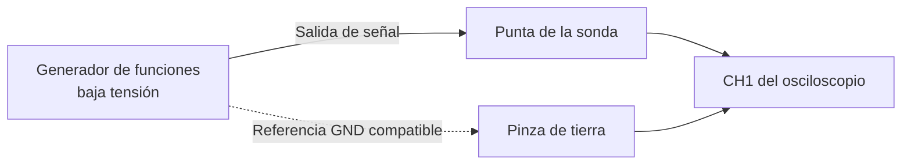

# 27.5 · Configuración inicial

> **Área:** Osciloscopio · Instrumentación y transmisión de señales  
> **Guía:** [Índice y navegación](./README.md)

Antes de conectar cualquier señal, revisa la **seguridad del montaje**, el tipo de sonda y la capacidad del osciloscopio. La siguiente configuración es un punto de partida para **señales conocidas de baja tensión procedentes de un generador de laboratorio**.

Esta configuración sirve como **punto de partida**, no como receta universal.

| Parámetro | Valor de partida para señal de prueba de 1 kHz / 4 Vpp |
|---|---|
| Tipo de señal | Senoidal de baja tensión |
| Canal | `CH1` activo |
| Sonda | `10X` física y `10X` en menú |
| Entrada | Impedancia alta compatible con sonda pasiva, normalmente `1 MΩ` |
| Acoplamiento | `DC` |
| Escala vertical | `1 V/div` |
| Escala temporal | `250 µs/div` |
| Trigger | `Edge`, `CH1`, flanco ascendente |
| Nivel de trigger | Aproximadamente `0 V` si no hay offset |
| Adquisición | `RUN`, modo de disparo `Auto` al inicio |

> [!TIP]
> Puedes utilizar `AUTOSET` para localizar la onda. Después ajusta manualmente `VOLTS/DIV`, `TIME/DIV` y `TRIGGER`; esa parte demuestra que comprendes el instrumento.

## Diagrama de conexión de laboratorio

**Atención con la carga del generador:** algunos generadores muestran la amplitud prevista para una carga de `50 Ω`. Si se conectan a una entrada de alta impedancia sin ajustar la carga mostrada a `Hi-Z`, el voltaje observado puede aproximarse al **doble** del configurado. Consulta las opciones `Load`, `50 Ω` y `Hi-Z` del generador antes de interpretar un error de amplitud.

---

## Lista de verificación antes de medir

- [ ] Reconocí marca, modelo y límites de entrada.
- [ ] Comprobé que la señal y su referencia son apropiadas para el equipo.
- [ ] Verifiqué que la sonda no tiene daños.
- [ ] Configuré el mismo factor de atenuación en sonda y canal.
- [ ] Seleccioné acoplamiento `DC` y un trigger apropiado.
- [ ] Revisé la terminación o carga (`Hi-Z`/`50 Ω`) indicada en el generador.

La [guía sobre sondas y tierra](./27.8-medicion-con-sonda-x1-y-x10.md) se debe leer antes de conectarlas.

---

[← Tema anterior: Partes y controles del equipo](./27.4-partes-y-controles.md) | [🏠 Índice del osciloscopio](./README.md) | [Tema siguiente: Cómo realizar una medición →](./27.6-como-realizar-una-medicion.md)
