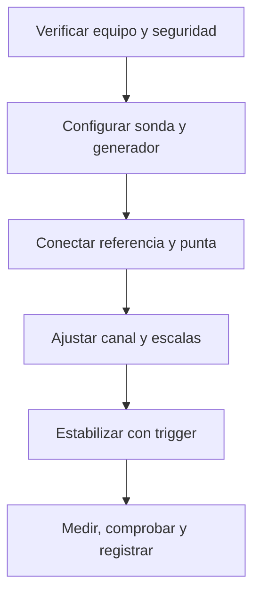

# 27.6 · Cómo realizar una medición

> **Área:** Osciloscopio · Instrumentación y transmisión de señales  
> **Guía:** [Índice y navegación](./README.md)

Este procedimiento está pensado para realizar la primera medición de laboratorio, siguiendo un orden repetible y registrando lo que haces.

> **Práctica inicial:** medir una senoidal de baja tensión procedente de un generador de funciones.

| Paso | Acción | Comprobación esperada |
|---|---|---|
| **1** | Identifica fabricante, modelo, canales y límites de entrada | Sabes qué instrumento tienes y qué puede medir |
| **2** | Revisa que los cables, puntas y sonda estén intactos | No hay daño visible |
| **3** | Enciende el osciloscopio y activa `CH1` | La pantalla y el canal responden |
| **4** | Selecciona en la sonda y el canal el mismo factor (`10X`) | Lectura correctamente escalada |
| **5** | Comprueba o realiza compensación de sonda según manual | Onda cuadrada de referencia sin deformaciones artificiales |
| **6** | Configura el generador en senoidal, 1 kHz, 4 Vpp, offset 0 V, con carga correctamente definida | Parámetros conocidos |
| **7** | Conecta referencia GND y punta a una salida de baja tensión segura | Conexión estable y correcta |
| **8** | Selecciona acoplamiento `DC` y `RUN` | Se adquieren muestras |
| **9** | Ajusta `VOLTS/DIV`, por ejemplo a `1 V/div` | La onda ocupa buena parte de la pantalla sin recortes |
| **10** | Ajusta `TIME/DIV`, por ejemplo a `250 µs/div` | Se ven aproximadamente 2–3 ciclos en una pantalla de 10 divisiones |
| **11** | Configura el trigger por flanco ascendente en CH1 cerca de 0 V | La onda deja de desplazarse |
| **12** | Activa mediciones automáticas de `Vpp`, `Frequency` y `Period`; comprueba también con divisiones | Los valores son coherentes con las fórmulas |
| **13** | Guarda captura y registra resultados | Evidencia técnica verificable |

> [!WARNING]
> Si no conoces la tensión o referencia del circuito real, **no lo conectes directamente**. El procedimiento anterior presupone una fuente de baja tensión conocida y adecuada para el instrumento.

---

## Diagrama del procedimiento

## ¿Cómo saber si la medición tiene sentido?

Compara los valores automáticos con al menos una comprobación manual. Por ejemplo, cuenta las divisiones de un ciclo para calcular `T` y luego `f = 1/T`. Una lectura automática sin contexto no demuestra por sí sola que la conexión o la configuración sean correctas.

---

[← Tema anterior: Configuración inicial](./27.5-configuracion-inicial.md) | [🏠 Índice del osciloscopio](./README.md) | [Tema siguiente: Medición de amplitud, frecuencia y período →](./27.7-medicion-de-amplitud-frecuencia-y-periodo.md)
