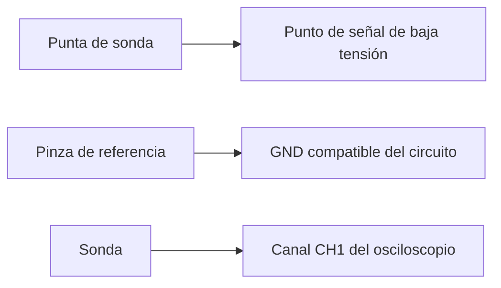

# 27.8 · Sonda X1 y X10: conexión, compensación y seguridad

> **Área:** Osciloscopio · Instrumentación y transmisión de señales  
> **Guía:** [Índice y navegación](./README.md)

La elección y conexión de la sonda es parte de la medición: una sonda mal ajustada o conectada puede producir resultados incorrectos y, en algunos circuitos, situaciones peligrosas.

La **sonda** lleva la señal desde el circuito hasta el canal del osciloscopio. Una sonda pasiva convencional tiene una punta, un conductor de referencia o pinza de tierra y, en ciertos modelos, un selector `1X/10X`.

## 5.1 Diferencia entre `1X` y `10X`

| Configuración | Qué significa | Uso habitual |
|---|---|---|
| `1X` | Atenuación nominal 1:1 | Señales pequeñas y frecuencias compatibles con la sonda |
| `10X` | Atenuación nominal 10:1 | Opción habitual para comenzar; generalmente carga menos el circuito |

Si la sonda está físicamente en **10X**, el menú del canal debe indicar **10X** (salvo detección automática). Si no coinciden, el voltaje indicado puede ser incorrecto por un factor de 10.

## 5.2 Compensación de la sonda

En una sonda pasiva 10X ajustable, la **compensación** corrige su respuesta capacitiva respecto al canal. Se verifica normalmente con la salida de referencia de onda cuadrada integrada en el osciloscopio, cuando exista.

1. Conecta la sonda al canal y configura la atenuación adecuada.
2. Conecta la punta a la salida de compensación y la pinza a su terminal de referencia.
3. Selecciona una escala que permita observar claramente la onda cuadrada.
4. Si el fabricante lo contempla, ajusta el compensador hasta observar mesetas planas y esquinas correctas.
5. Si la sonda es de compensación automática, utiliza su procedimiento específico.

Una sonda mal compensada puede mostrar bordes redondeados o picos artificiales que no pertenecen a la señal original.

## 5.3 Seguridad eléctrica: leer antes de conectar

> [!CAUTION]
> En **muchos osciloscopios de sobremesa**, la parte metálica exterior del conector BNC y la pinza de tierra de una sonda convencional están conectadas a **tierra de protección**. Conectar esa pinza a una fase de red, a un conductor energizado o a un punto que no deba unirse a tierra puede provocar un cortocircuito, dañar equipos y causar lesiones.
>
> **No anules la toma de tierra del osciloscopio** para intentar una medición flotante. No midas directamente la red eléctrica ni dos puntos energizados con una sonda convencional. Esas aplicaciones requieren un método e instrumentación expresamente adecuados —por ejemplo, una sonda diferencial con clasificación apropiada— y supervisión de personal competente.

En prácticas introductorias, utiliza **un generador de laboratorio de baja tensión** y confirma que su referencia es compatible con la del osciloscopio. Verifica también los límites nominales del canal y de la sonda en sus manuales.

**Orden general de conexión:** con el circuito preparado y en condiciones seguras, conectar sonda al osciloscopio → conectar referencia a GND apropiado → conectar punta al punto de medición. Al retirar: quitar primero la punta, después la referencia. No sujetar superficies conductoras expuestas durante la medición.

---

## Diagrama de conexión simplificado

> [!IMPORTANT]
> La pinza de referencia de una sonda convencional **no es un terminal aislado**. Revisa el manual del modelo específico y la referencia del circuito antes de medir.

---

[← Tema anterior: Medición de amplitud, frecuencia y período](./27.7-medicion-de-amplitud-frecuencia-y-periodo.md) | [🏠 Índice del osciloscopio](./README.md) | [Tema siguiente: Ejemplos y prácticas de laboratorio →](./27.9-ejemplo-practico.md)
